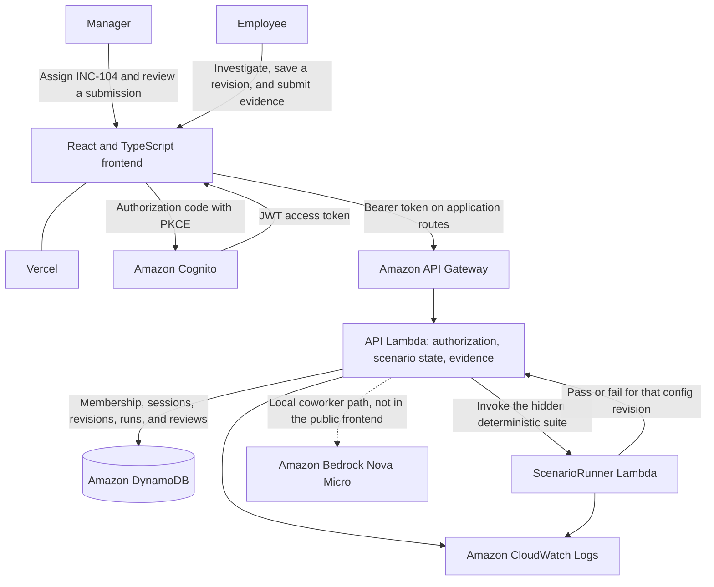

# OnboardOS

Learn the job by doing the job.

OnboardOS lets a new cloud engineer practice one realistic incident in a controlled workplace. The employee investigates, changes a service setting, and gets a deterministic AWS test result. A manager reviews the frozen evidence and makes the final call. The app and sign-in screen use the name AWS. Sign-in is Amazon Cognito. The incident, ticket, and diagnostics remain a simulation.

## Overview

Most onboarding explains tools one at a time. The actual job mixes a ticket, a runbook, logs, a configuration change, and a written explanation.

OnboardOS connects those steps. The incident content is synthetic. Sign-in, saved work, and test execution use AWS. A language model can coach from the local codebase, but it cannot mark a test passed and it cannot approve an employee.

## What it does

1. A manager assigns the published simulation.
2. The employee reads the ticket, conversation, runbook, and synthetic diagnostics.
3. The employee saves a configuration revision.
4. A private Lambda runs the hidden checks for that revision.
5. The employee submits a report, and that attempt's evidence is frozen.
6. The manager approves the submission or requests a revision.

The example is **INC-104, Checkout API timeouts**: an old 800 ms timeout against a saved 1800 ms value. Employers cannot yet create new executable simulations. The local Manager Coaching Studio only edits coaching text for a scenario that already exists, and it is not on the public site.

## System architecture



The browser talks only to Vercel, Cognito, and API Gateway. The API Lambda checks membership and ownership, applies the scenario reducer, and stores records in DynamoDB. ScenarioRunner has no database access. The dotted Bedrock arrow is the local coworker: the API builds the Nova Micro request and withholds a reply that contradicts session evidence. That UI is not deployed.

| Service | Purpose | Status |
| --- | --- | --- |
| Amazon Cognito | Hosted sign-in with authorization code and PKCE. Application routes require a JWT. | Deployed / confirmed |
| Amazon API Gateway | HTTP API. `GET /health` is public. Other routes use the JWT authorizer. | Deployed / confirmed |
| AWS Lambda, API | Authorization, scenario state, submissions, and reviews. | Deployed / confirmed |
| AWS Lambda, ScenarioRunner | Private deterministic INC-104 suite for one saved revision. | Unable to verify |
| AWS Lambda, smoke function | Operator-only DynamoDB check. No public route. | Infrastructure-only |
| Amazon DynamoDB | Membership, assignments, sessions, revisions, test runs, submissions, and reviews. | Unable to verify |
| Amazon CloudWatch Logs | A log group for each Lambda function in the template. | Infrastructure-only |
| AWS IAM | Separate roles for the API, runner, and smoke function. | Infrastructure-only |
| Amazon Bedrock | Nova Micro through Converse, called only by the API for the coworker. | Implemented locally / not deployed |

Public app: [onboard-os-nine.vercel.app](https://onboard-os-nine.vercel.app). On 8 Nov 2026, `/health` returned 200 and anonymous `/v1/me` returned 401. That bundle has INC-104 and no coworker or Coaching Studio. Live table contents and a runner call were not rechecked. GitHub `main` is behind this branch.

## Technology stack

- **Frontend:** React 19, TypeScript, Vite, React Router, hosted on Vercel.
- **Backend:** TypeScript on Lambda, Zod contracts, API Gateway, Cognito, and DynamoDB.
- **Simulation:** an in-process scenario reducer and a separate ScenarioRunner Lambda.
- **AI:** Bedrock Converse with Nova Micro, local on this branch.
- **Infrastructure:** AWS SAM / CloudFormation, IAM, and CloudWatch Logs.

## Running locally

Node.js 20+ and npm 10+ are required.

```sh
npm ci
cp apps/web/.env.example apps/web/.env.local
npm --workspace=apps/web run dev
```

Open [http://localhost:5173](http://localhost:5173). Set `VITE_API_BASE_URL`, `VITE_COGNITO_CLIENT_ID`, `VITE_COGNITO_DOMAIN`, `VITE_COGNITO_USER_POOL_ID`, and `VITE_AWS_REGION` from the stack outputs. Leave `VITE_COWORKER_ENABLED` and `VITE_COACHING_STUDIO_ENABLED` unset until those routes are deployed.

```sh
npm test
npm run typecheck
npm run verify
```

`npm run verify` includes `sam build`. It does not deploy.

## Current scope

Shipped work is one scenario, INC-104, with the manager and employee flow above. Coaching Studio and Coworker v3.1 are local, tested, and not deployed. v3.1 has not had a real-model evaluation. A Scenario Studio for employer-authored simulations is future work.

## Repository

[GitHub](https://github.com/5675413-starfish-industries-5675413/OnboardOS) · [Deployed frontend](https://onboard-os-nine.vercel.app)

Also see [deployment](docs/aws-deployment.md), [scenario engine](docs/03-scenario-engine.md), [coworker design](docs/ai-coworker-architecture.md), [demo script](docs/12-demo-script.md), and [agent instructions](AGENTS.md).

## Direction

Review the local coworker and coaching editor before any deployment. Future scenario authoring must leave the hidden checks deterministic.
