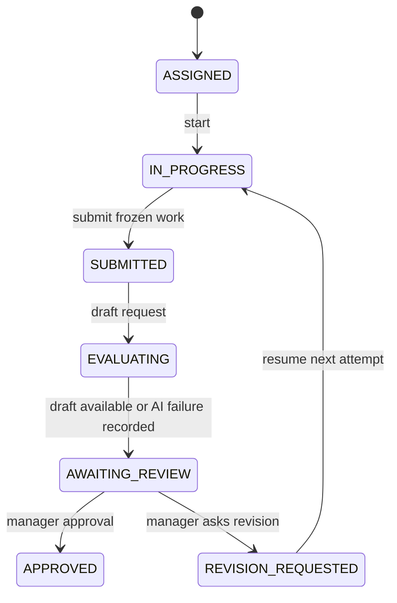

# 03 — Deterministic Scenario Engine and INC-104

## Core principle

The scenario engine is a pure TypeScript package, not a Bedrock prompt and not a frontend mock. It receives an immutable scenario definition, current workplace state, validated semantic action, and returns deterministic next state plus events or a rejected action.

No LLM can decide pass/fail or invent state mutations. No frontend request can specify its own `passed=true` result. AI-generated coworker text is recorded as content only.

## Scenario definition

`ScenarioTemplate` (versioned, never silently edited in active assignments): `id`, `organizationId`, `version`, `roleBlueprintVersion`, `enabledToolIds`, `employeeVisibleFacts`, `initialState`, `permittedActions`, `testSuiteId`, `testSuiteVersion`, `rubricVersion`, `scenarioPolicy`.

**Secrecy boundary:** employee-visible fixture data and knowledge documents are separate from private expected outputs/hidden test cases. The server-side test suite must never be bundled into client code or supplied to coworker prompts.

## Initial incident: INC-104

Fictional `Northstar Cloud` junior cloud engineer investigates checkout API request failures caused by an overly short upstream timeout. A system runbook defines the approved maximum of 2,000 ms. An incident ticket notes increased 504 responses after a service-config change. Synthetic logs include requests taking 1,200–1,600 ms.

- Initial config: `{"request_timeout_ms":800}`.
- Allowed parameter: integer 100–2,000 milliseconds.
- Base deterministic suite: schema valid, permit policy, 1,200ms upstream request, 1,600ms upstream request, correct revision hash.
- Example: 800ms fails latency cases; 1,400ms passes one; 1,800ms passes both; 5,000ms fails range policy.
- This is a **toy model** used to verify the evidence pipeline, not a claim that real incidents can be repaired by adjusting one value.

**Preferred improvement if ahead of schedule:** introduce `max_retries` (0–2) and `retry_backoff_ms` and include additional deterministic cases for retry amplification and end-to-end budget. Rework tests and runbook accordingly; do not add superficial knobs with no effect on test behavior.

## State machine



Track assignment state, session working-state, submission revision, evaluation status, and human review as distinct records. Changing the editor after `SUBMITTED` must create a new revision only after a permitted reopen/revision workflow.

## Engine interface (planned)

```ts
export type WorkplaceAction =
  | { type: 'OPEN_TICKET'; ticketId: string }
  | { type: 'OPEN_RUNBOOK'; runbookId: string }
  | { type: 'START_INVESTIGATION' }
  | { type: 'SAVE_CONFIG'; config: { request_timeout_ms: number }; expectedVersion: number }
  | { type: 'SUBMIT_REPORT'; report: IncidentReport; expectedVersion: number };

export interface TransitionResult {
  nextState: WorkplaceState;
  events: DomainEvent[];
}

export function reduceScenario(
  definition: PublishedScenario,
  state: WorkplaceState,
  action: WorkplaceAction
): TransitionResult;
```

Test runs, messages, and AI inference are **I/O operations** managed by backend services. Do not call AWS inside this pure reducer.

## Test execution protocol

1. Employee saves validated config to a numbered, hashed revision.
2. `POST /sessions/:id/test-runs` supplies `configRevision` and idempotency key.
3. API checks session ownership, permitted state, revision existence, and quota.
4. API atomically creates `TestRun` as `PENDING` and `TEST_RUN_REQUESTED` event, then invokes the dedicated **predefined** runner with server-derived suite ID and trusted config.
5. Runner evaluates fixture cases and returns structured results. It cannot access arbitrary user-selected AWS services or credentials.
6. API persistently marks `PASSED/FAILED/ERROR`, records executor reference and exact `configHash`/suite version, then appends `TEST_RUN_COMPLETED` event. Retries must be idempotent.
7. If config is edited later, its current hash no longer matches the prior run and the UI presents `STALE` relative to the current revision.

Error/timeout is **not** a pass; incomplete test runs must have a visible status. With a synchronous path, ensure no false `PENDING` result is left on any exception; with asynchronous completion, maintain a bounded reconcile/retry policy.

## Engineering invariants

- Session owner and scenario assignment immutable for active session.
- Published scenario version frozen for each assignment.
- State version increments monotonically; stale expected versions conflict (409).
- Every successful authoritative state transition has exactly one associated server-originated event.
- Saved config has canonical hash; tests identify exact revision, hash, suite version.
- A new saved config revision invalidates previous pass for **current** work (historical results remain).
- Submission freezes report, config, test-run references, and employee identity.
- Manager approval is a separate append-only human decision.
- A reset creates a fresh attempt/session with its own history rather than rewriting prior evidence.
- AI output cannot mutate role, tests, assignment approval, IAM, or scenario version.

## Deliberate demo of mistakes

The walkthrough **should first fail** at 800ms and then pass at 1800ms; evidence changes for an explicit reason. Show the `STALE` state by editing after a pass (optional live moment if smooth). The manager sees both failures and successes rather than only the final green check.
