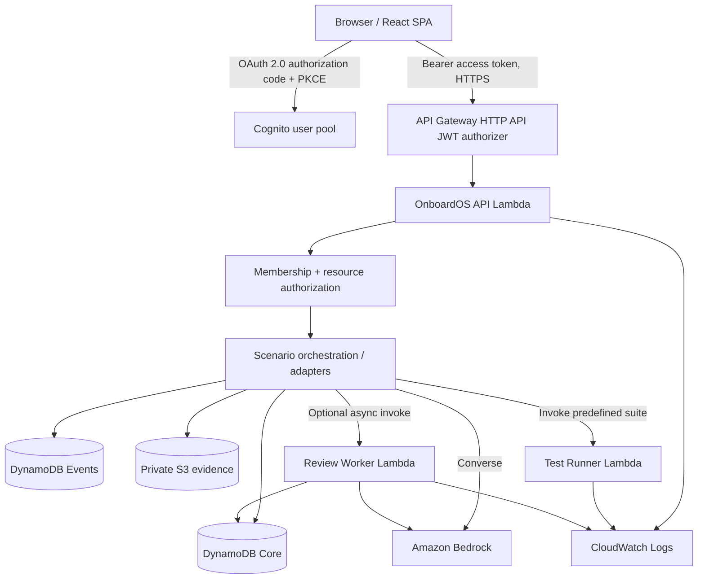

> **Implementation note (2026-11-08).** This freeze records intended trust boundaries. The SAM template does not create Amazon S3 or AWS Amplify. The public frontend is on Vercel. Bedrock coworker support in this branch is local and is not in the public frontend. Rows below that name S3 or Amplify are unused plans, not deployed services. The early architecture note now lives at `docs/archive/01-architecture-and-aws.md`.

# OnboardOS — Architecture Freeze v1.1

**Status:** Approved *design baseline* for AWS × A10 hackathon, November 7–8, 2026. Not a claim that the infrastructure exists or that tests have passed. This document supersedes conflicting choices in `docs/archive/01-architecture-and-aws.md`, `03-scenario-engine.md`, `04-data-and-api.md`, and `11-decisions.md`. Preserve those documents as explanatory references.

**Product:** OnboardOS — *Learn the job by doing the job.* A multi-tenant enterprise onboarding SaaS whose primary resource is an authorized, stateful, scenario-bound *workplace session*. Organizations configure an environment; managers assign work; employees execute bounded actions across interconnected simulated tools; a human manager reviews verifiable technical evidence with optional Bedrock assistance.

**Demonstration:** A fictional employer, Northstar Cloud; one junior cloud engineer; incident INC-104 (checkout API timeout); three named account roles (organization admin, manager, employee); one cohesive assignment → investigation → versioned configuration → actual Lambda test execution → frozen submission → AI assessment draft → manager review loop. Neither real AWS employment nor private Amazon internal systems are represented.

## A. Frozen decisions and non-goals

| ID | Decision | Rationale |
|---|---|---|
| AR-01 | npm-workspace TypeScript monorepo; modular monolith | Shared contracts, simple GitHub integration and deployment |
| AR-02 | React/Vite SPA, React Router, Tailwind/shadcn, TanStack Query, Zustand; Monaco for config only | Rich client workspace without SSR infrastructure |
| AR-03 | HTTP API Gateway + protected API Lambda; separate predefined test-runner Lambda; dedicated AI-review worker only if permitted / required by latency | Maintain security boundaries and avoid service sprawl |
| AR-04 | DynamoDB (`OnboardOSCore`, `OnboardOSEvents`) is authoritative; S3 stores large immutable artifacts and export bundles | Clear current-state and evidence access patterns |
| AR-05 | Cognito public SPA app client with PKCE, and API Gateway JWT authorizer; backend organization membership authorization | Authentication is not tenant authorization |
| AR-06 | Pure TypeScript scenario reducer, bounded commands and adapters | All tools share the same deterministic workplace state |
| AR-07 | Test results are server-produced, tied to immutable config hash/revision and test suite | Prevent misleading stale passing indicators |
| AR-08 | Bedrock AI coworker and assessment assistant cannot mutate permissions, test verdicts or approvals | AI is not authoritative |
| AR-09 | Structured evidence timeline first; no unapproved full-screen recording | Privacy and trustworthy evidence |
| AR-10 | AWS SAM deploy from `main` by one owner; record commit SHA | Reproducible deployment, reviewable state |
| AR-11 | Host SPA on Amplify if permitted, otherwise Vercel; AWS always hosts substantive compute, data and model calls | Workshop account may be limited |
| AR-12 | Workshop Studio-issued temporary credentials only; verify actual service operation rather than catalog/list visibility | Limit assumptions about restricted event account |

Not in hackathon: arbitrary code execution, real production AWS account access, real Slack/Jira/GitHub OAuth, a browser clone of enterprise products, dedicated EC2/ECS workstations, autonomous employee competence decisions, full visual replay, broad role catalog, billing, enterprise SSO, multi-agent orchestration, generic AI-generated scenario tests.

## B. Trust domains and top-level deployment



- **Browser trust domain:** UI, local drafts, access tokens, tenant-scoped GET/POST requests. No AWS access key/secret/session token, hidden test suite, administrator credentials or policy override.
- **API trust domain:** verified authentication, organization and resource permission checks, request parsing, rate limits, scenario state orchestration, data access, generation of server-derived tool context.
- **Runner trust domain:** predefined suite ID, validated revision snapshot; no arbitrary code, shell commands or employee-selected Lambda ARN; no broad database or IAM access.
- **Bedrock trust domain:** text generation/analysis only; no direct write path to state, code execution, review approval, or AWS identity controls.
- **Evidence trust domain:** server-generated events and snapshot manifests. Client-claimed success is never evidence of successful test execution.

Frontend hosts only public SPA assets. Cognito accounts are not IAM users, and OnboardOS organization admin is **not** AWS administrator. Hosting the SPA on Vercel (if needed) does not change which AWS components produce the real product functionality.

## C. Identity, membership and authorization

**Actor roles:** `org_admin`, `manager`, `employee`. AI coworker is a named simulated actor, not an authenticated employee or human reviewer.

**Membership:** `(organizationId, userSub, role, teamIds, status)` where `userSub` is derived from a verified identity token. No globally privileged `role` property on User. A user may have different roles in different organizations.

**Backend authorization procedure, for every protected action:**
1. Validate JWT on Gateway; Lambda accepts only claims passed by configured authorizer and enforces proper token use / audience configuration.
2. Resolve user's active membership in the *resource's* organization.
3. Verify membership active, role permission and team/assignment scope.
4. Verify scenario published version, assignment and session owner / reviewer relationship.
5. Validate allowed action in this session's current state; reject or redact unauthorized resources.
6. Build `AuthorizedSessionContext` on server; only then invoke reducer/tool adapter.

**Role matrix:**

| Action | Org admin | Scoped manager | Employee |
|---|---|---|---|
| Add/update organization members, designate managers | Yes | No | No |
| Configure/publish role blueprint and scenario | Yes | Allowed scope only | No |
| Assign published scenario | Yes | Managed team | No |
| Enter workplace session | Explicit preview | Read-only preview | Own assigned session |
| Save configuration and run tests | Preview session only | Preview session only | Own active session |
| Read submission evidence | Authorized org/team | Assigned employee | Own evidence |
| Approve / request revision | Authorized org scope | Assigned employee | No |
| Change retention policy or org-wide permissions | Yes | No | No |

**MVP identity:** three real identities with real backend role enforcement. Preferred Cognito hosted login / PKCE. If workshop Cognito create permissions are blocked, use one explicitly labeled demo-only signed-session implementation with separate users and the same backend membership validation, but never treat a client-side role selector as auth. Do not submit real employee data to a public demo.

## D. Functional architecture: organization to review

1. **Organization Studio:** Admin views membership directory, cloud-engineer blueprint, enabled tools, published scenario. MVP: seeded org/accounts, one editable blueprint property that actually affects *new* assignments (e.g. chat enabled) and role-scoped access.
2. **Manager Assignment:** Manager selects member of managed team + published scenario version, starts assignment and seeds a new workplace session. Save assignment with correct employee and reviewer scopes.
3. **Employee Workspace:** Incident tab, synthetic diagnostics, chat, documentation, Monaco config editor, tests, incident report, activity timeline. All write operations go through API domain commands.
4. **Tool Adapter Boundary:** `ticket.read/comment`, `docs.read`, `chat.post`, `diagnostics.read`, `config.save`, `test.run`, `report.submit`; each adapter has declared capabilities and returns structured outcomes. No direct general AWS SDK access from employee UI.
5. **Test Execution:** Save canonical, validated immutable config revision; run predefined tests in a dedicated Lambda against server-loaded inputs; persist `TestRun` result, revision/hash/suite version and execution reference. Employee can correct and rerun.
6. **Submission:** Freeze submitted report, exact config hash/revision, test run ID and rubric/scenario version in immutable submission. Earlier attempts remain readable.
7. **Evaluation:** Assemble the *frozen* evidence bundle; Bedrock drafts specific feedback with validated references; if AI times out/fails, the submission stays human-reviewable with an explicit AI error.
8. **Manager Review:** Manager inspects employee timeline, revision diff, test suite outcomes and AI commentary, then writes an immutable human decision `APPROVE` or `REQUEST_REVISION`. A revision opens a subsequent attempt, never overwrites the former record.

**Workplace shared state:** Ticket, chat, documentation, diagnostics, config, testing and report are projections of one session and published scenario; changing one surface can legitimately change the other surfaces' *state*. Do not fake synchronized screens using independent arrays of frontend fixture data.

## E. Domain model and lifecycle

**Entities:** `Organization`, `Membership`, `Team`, `RoleBlueprintVersion`, `ScenarioTemplateVersion`, `Assignment`, `WorkplaceSession`, `ConfigRevision`, `TestRun`, `ChatMessage`, `DomainEvent`, `Submission`, `EvaluationDraft`, `ManagerReview`, `Artifact`.

**Assignment status:** `ASSIGNED` → `IN_PROGRESS` → `SUBMITTED` → `EVALUATING` → `AWAITING_REVIEW` → (`APPROVED` or `REVISION_REQUESTED`). Revision request returns the assignment to `IN_PROGRESS` for a new attempt. An AI error moves evaluation to `AWAITING_REVIEW` with `evaluationStatus=ERROR` so it cannot deadlock the employee. Keep `assignmentStatus`, `testRunStatus`, `evaluationStatus` and `reviewDecision` separate.

**Test-run status:** `PENDING` → `RUNNING` → (`PASSED` / `FAILED` / `ERROR`). Retried execution of the same `testRunId` must be idempotent. A test is *current* only when its `configHash`, `configRevision`, and `testSuiteVersion` equal the snapshot referenced by the latest allowed submission/current editor.

**Invariants:**
- Published scenario version and assigned employee are frozen for a running assignment.
- Every authoritative successful action increments state version and creates one matching server-side event.
- Optimistic-concurrency conflicts return 409 rather than overwriting changes.
- External Lambda/Bedrock calls occur outside DynamoDB transactions; `PENDING/RUNNING/COMPLETE/ERROR` records describe asynchronous work.
- Changing the config after a passing test makes old evidence stale for current work; do not delete old historical evidence.
- Approval belongs to the manager's authenticated identity and the immutable submission ID.
- Reset creates a fresh session/attempt, not a silent rewrite of history.
- Model instructions, prompts, external documents and generated text are untrusted data, not executable authority.

## F. Storage design and explicit access patterns

**Two DynamoDB tables:**
- `OnboardOSCore(PK, SK)` plus GSIs needed for employee assignment and manager queue; items carry `organizationId` and version. Suggested items: `ORG#id/PROFILE`, `ORG#id/MEMBER#sub`, `ORG#id/SCENARIO#id#vN`, `ASSIGN#id/META`, `SESSION#id/STATE`, `SESSION#id/CONFIG#vN`, `SESSION#id/TEST#timestamp#id`, `SESSION#id/SUBMISSION#attempt`, `SUBMISSION#id/REVIEW#id`. Backend must verify the item's resource org against membership before revealing it.
- `OnboardOSEvents(PK=SESSION#id, SK=SEQ#zeroPaddedN)`; immutable records contain `organizationId`, `actorId`, event type, state version, time and sanitized payload/evidence ID. Sequence allocated server-side.

**GSI-1** employee assignments: `GSI1PK=ORG#orgId#EMP#userSub`; `GSI1SK=ASSIGN#createdAt#id`. **GSI-2** manager review queue: `GSI2PK=ORG#orgId#MANAGER#userSub`; `GSI2SK=REVIEWABLE#status#submittedAt#id`. These attributes must be written/updated deliberately when assignment status becomes reviewable; no cross-tenant table scans.

**Write transaction:** `Update session with condition stateVersion == expected` + `Put event if absent` + `Put operation-ledger record if absent`, atomically. DynamoDB's transaction `ClientRequestToken` only deduplicates within 10 minutes; persistent business idempotency ledger is needed beyond that interval. See AWS API documentation: https://docs.aws.amazon.com/amazondynamodb/latest/APIReference/API_TransactWriteItems.html .

**S3 private artifact bucket:** store larger reports, immutable exported evidence manifest, future replay chunks. Small textual report may live in Core initially; don't introduce object uploads just for architectural theater. S3 presigned URL only after server authorization, with short expiry and immutable object keys. Require default block-public-access and encryption. **S3 does not replace DynamoDB as live state store.**

## G. API and contract conventions

- API root: `/v1`; JSON request/response. Zod schemas are shared with frontend only for *public* types. Private test suite definitions never imported into `apps/web`.
- Auth identity and role are server-derived, not provided by client.
- Mutations accept `Idempotency-Key` (where meaningful); state writes use `expectedStateVersion`.
- Success responses return server version and server-assigned identifiers.
- Errors use `{code,message,requestId}`, with 401 unauthenticated, 403 forbidden, 404 not found/not accessible, 409 conflict, 422 invalid scenario action, 429 quota, 5xx system failure.

**Minimum routes:**

| Method | Route | Purpose |
|---|---|---|
| GET | `/v1/health` | Public minimal readiness, no internal secrets |
| GET | `/v1/me` | Authenticated identity & memberships |
| GET/POST | `/v1/orgs/:orgId/assignments` | List scoped / manager assign |
| POST | `/v1/assignments/:id/start` | Start/resume own session |
| GET | `/v1/sessions/:id` | Authorized workplace state |
| POST | `/v1/sessions/:id/actions` | Validated semantic action |
| PUT | `/v1/sessions/:id/config` | Save schema-valid revision |
| POST | `/v1/sessions/:id/test-runs` | Run immutable revision's predefined test suite |
| GET | `/v1/sessions/:id/test-runs/:runId` | Poll actual execution result |
| POST | `/v1/sessions/:id/messages` | Context-bounded AI coworker, if enabled |
| POST | `/v1/sessions/:id/submissions` | Frozen report and evidence references |
| GET | `/v1/reviews/:submissionId` | Scoped manager evidence bundle |
| POST | `/v1/reviews/:submissionId/decision` | Manager approve/request revision |

## H. Real AWS test-runner protocol

1. Frontend saves revision; server validates allowed JSON shape and hashes canonical serialized config.
2. Employee requests test for a saved revision (not arbitrary unsaved browser content).
3. API authorizes, checks exact `sessionId`, suite ID, revision hash and quota.
4. API writes `TestRun(PENDING)` and event/idempotency record atomically.
5. API invokes only configured `OnboardOSScenarioRunner` Lambda using a **server-built payload** `{testRunId,scenarioVersion,suiteId,configSnapshot,configHash,suiteVersion}`. The API obtains the immutable configuration snapshot from DynamoDB after authorization; the client cannot choose the test suite. The runner has **no DynamoDB write permissions** and no public endpoint. **Never trust a client-provided hidden suite or expected outcome.**
6. Runner performs bounded, deterministic test fixtures: initial 800ms fails; valid 1800ms passes; out-of-policy input cannot be saved; test results carry exact config revision/hash and suite version. Runner returns results to API, which validates the echoed `testRunId`/hash and commits result + event. This is real Lambda execution of synthetic incident fixtures, not real production incident repair.
7. API persists results conditionally and emits `TEST_RUN_COMPLETED`. Duplicate results for the same run ID cannot create duplicate success events; an invocation failure is recorded as `ERROR`, not `PASSED`.
8. Frontend polls `GET /test-runs/:id` until PASSED/FAILED/ERROR. Timeout/errors are not success; stale status is computed against latest saved revision.

**Hackathon execution decision:** invoke the short, fixed test runner synchronously with `lambda:InvokeFunction(RequestResponse)`, **after** saving the `PENDING` record; enforce a tight runner timeout. Use idempotent run IDs, record terminal failures, and provide a retry path for a stranded `PENDING` operation. Longer-running future execution adapters may use asynchronous invocations with independent result persistence. Do not introduce Step Functions for this suite.

## I. Bedrock and AI evaluation architecture

**Coworker:** Authorized employee asks question → API loads only employee-visible scenario, public runbook, bounded recent messages, and current non-secret state → Bedrock Converse → validate and persist text reply. The AI cannot read hidden tests or manager-only annotations, cannot take tool actions, and cannot fabricate test results.

**Assessment:** After submission, freeze exact evidence → set `evaluationStatus=PENDING` → call Bedrock with manager-approved rubric and evidence IDs → return structured strengths, concerns, `evidenceIds`, summary, `requiresHumanReview=true` → verify evidence references exist and belong to submission → save draft. Human manager may disagree. If a Bedrock call is slow, a dedicated review Lambda async worker is preferred and manager UI polls. It must be idempotent, observe concurrency limits, and mark errors clearly; when event invocation retries, a duplicate worker invocation must not create a second evaluation or overwrite a completed one.

**Model settings:** Bedrock model ID / inference profile from verified Workshop account availability, model invocation access—not mere catalog listing. Use stable limited schema and server-side Zod validation. Bedrock structured outputs depend on model/profile, and some JSON-schema keywords are unsupported. Keep prompt templates versioned; log model ID and latency without logging secrets or unnecessary private employee content.

## J. Security / privacy / operability baseline

- Public demo only with synthetic company data and test accounts. No private employer records.
- Browser credentials never include AWS IAM keys; all AWS API calls originate from Lambda execution roles.
- Distinct least-privilege API and test-runner roles; scope `lambda:InvokeFunction` to specific ARN, DynamoDB to named tables, S3 to private bucket/prefixes, Bedrock inference to approved resources.
- Hard cap on tests per session, Bedrock messages, payload sizes, artifact sizes and concurrent runs. Limit Lambda timeouts and CloudWatch retention where permitted.
- CORS allowlist for known frontend URL; never treat CORS as authentication. Do not expose a powerful production API without backend authorization.
- Don't record employee desktop, personal apps or entire browser. Structured work events only for MVP; explicit notice and masking for future replay.
- Protect against prompt injection in chat, incident text, reports: tools and model output never become policy or IAM instructions.
- Protect model availability failure: human review can proceed when AI feedback errors, with error disclosed.
- Workshop account may be deleted or reset. Preserve documentation, infrastructure template, code, screenshots and demo recording outside the temporary account; don't claim permanent hosted availability.

## K. UI route contract

| Route | View | Access |
|---|---|---|
| `/login` | Cognito sign-in | Public |
| `/app` | Org selector | Signed-in |
| `/org/:orgId/studio` | Organization Studio | Org admin |
| `/org/:orgId/manager` | Manager assignments & review queue | Scoped manager/admin |
| `/org/:orgId/employee` | Employee assignments | Employee |
| `/sessions/:sessionId` | Interactive workplace | Session owner; explicitly limited manager preview |
| `/reviews/:submissionId` | Frozen evidence & manager decision | Authorized reviewer |

UI has responsive navigation but desktop-first workflow. Present *synthetic logs* as synthetic evidence and *actual Lambda test results* as actual execution. Never call a locally generated fake result a CloudWatch result.

## L. Repo and deployment ownership

```
onboardos-aws-hack-2026/
  apps/web/                       # React SPA
  services/api/                   # Lambda entry + domain + auth + adapters + Bedrock
  services/test-runner/           # private fixed test suite
  services/review-worker/         # optional async Bedrock assessment
  packages/contracts/            # public Zod/TS schemas
  packages/scenario-engine/      # pure deterministic reducer
  packages/scenario-fixtures/    # ONLY employee-visible data
  infrastructure/template.yaml   # SAM where permitted
  scripts/seed-demo.ts
  docs/                           # design, decisions, QA, Devpost
  .github/workflows/verify.yml
  CLAUDE.md
```

- Branches: short feature branches and PRs to `main`. Only the release owner deploys the AWS stack. Record deployed commit SHA, region, model ID, API URL, frontend URL, smoke test results; never secrets.
- Tests: pure reducer, authorization/membership/tenant boundaries, revision-hash stale tests, idempotent retries, simulation fidelity, AWS integration smoke tests, full browser loop.
- Cut order: invites/billing/extra scenarios/replay/real external integrations first; never cut backend authorization, genuine test-runner proof, persistent submission, or human review.

## M. Release acceptance / demo truths

1. Admin/manager/employee each have separate authenticated permission contexts.
2. A manager can assign INC-104 to a permitted employee; only that employee can start/update session.
3. Opening the issue, logs and docs shows coherent shared incident facts, not disconnected frontend fixtures.
4. Saving 800ms then running real Lambda tests records expected failure; saving 1800ms and rerunning records expected success.
5. A further config edit clearly marks earlier passing evidence stale.
6. A submission binds report + saved config hash + real test-run ID + scenario/rubric version.
7. Bedrock produces real evidence-grounded draft **or** its failure is truthfully shown; it cannot approve the submission.
8. Manager sees immutable evidence and may approve or request revision; employee cannot self-approve via API.
9. AWS request IDs, logs or execution references substantiate genuine cloud operations. No screenshots or videos are synthetic representations claimed as live output.
10. GitHub `main`, deployed build, README, source code, Devpost and recording describe the same actual functionality.

**Final rule:** This freezes *interfaces, trust boundaries and invariants*. It does **not** assert AWS workshop permissions. Before creating resources, perform the service-specific preflight in `15-aws-provisioning-order.md`; if a service is restricted, write an ADR describing the smallest compliant substitute before changing contracts.
