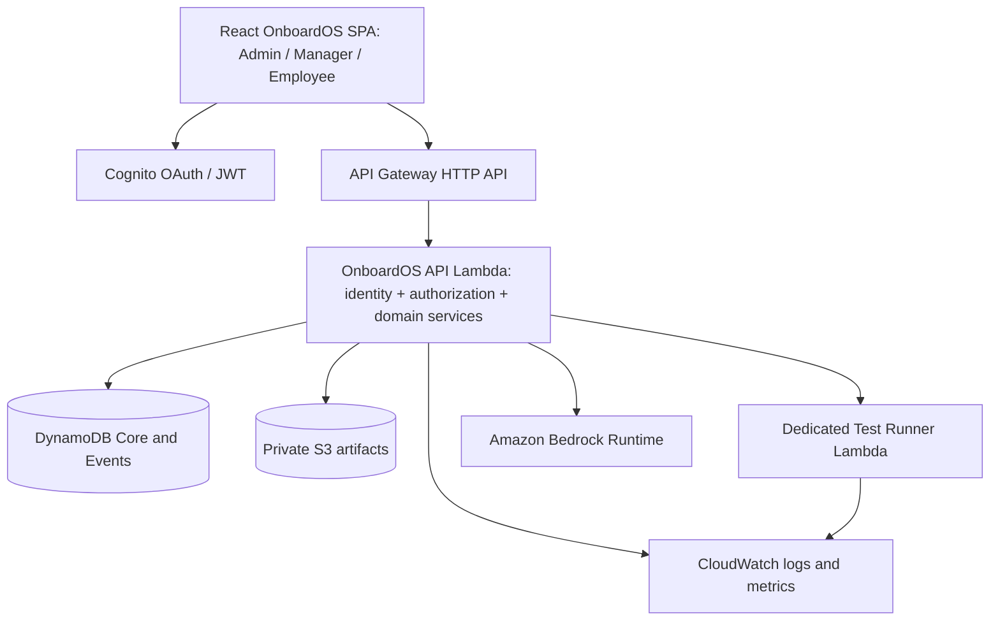

> **Archived on 2026-11-08.** This file is an early planning note. It is not a description of the running product. The current overview is [the project README](../../README.md). The implemented AWS resources are in `infrastructure/template.yaml`.

# 01 — Full-stack architecture, AWS choices, and deployment boundaries

## Decision summary

**Stack:** React + Vite + TypeScript SPA; Tailwind + shadcn/ui; React Router; TanStack Query for server state; Zustand for ephemeral UI state; Monaco for bounded configuration editing; React Hook Form + Zod if needed. TypeScript backend on Lambda; npm workspaces; Node.js 24 where available; AWS SDK v3; esbuild bundling; AWS SAM IaC.

**Do not** add Next.js SSR, microservices, Docker, EKS, ECS, WebSockets, EventBridge, Step Functions, a vector database, or generic agent orchestration merely to impress judges. Add only if a specific user action fails without it.

## Service matrix

| Service | Why | Hackathon rule | Fallback |
|---|---|---|---|
| API Gateway HTTP API | HTTPS API entry; JWT verification when configured | P0 | Other authorized API entry with equivalent auth |
| Lambda API | Session authorization, validated actions, persistence | P0 | Single managed Node backend if provisioning blocked |
| Lambda test runner | **Real AWS executed** bounded predefined tests | P0 | None for claim of AWS-backed testing; revise claim if unavailable |
| DynamoDB | Authoritative state, audit events, assignments | P0 | Different AWS-authorized persistence only with documented change |
| Bedrock | Coworker and evidence-grounded draft feedback | P0 one flow | Visible limited availability if model access denied; cannot claim it works |
| CloudWatch | Real function logs and debugging | P0 | AWS service logs already available |
| Cognito | Real user sign-in | Preferred | Server-side signed demo sessions with isolated users only if permitted; disclosed |
| S3 | Artifacts and replay chunks | Preferred | Small artifacts can temporarily live in DynamoDB within item size limit |
| Amplify Hosting | Convenient AWS frontend hosting | Optional | Vercel static Vite hosting |
| CodeBuild/ECS/Fargate | Later sandboxed code, long-lived environments | **Not MVP** | None necessary |
| Step Functions/EventBridge | Future asynchronous orchestration | **Not MVP** | Direct bounded calls |

## AWS region and identities

- Set `AWS_REGION` based on organizer-supported regions and **actual model invocation access**, not assumptions from catalog listing.
- Preferred baseline `nodejs24.x` if compatible with account restrictions; verify supported SAM build image and runtime.
- Three authenticated human personas: administrator, manager, employee. The same user's **organization membership** owns role, not a global user flag.
- Cognito for client login: public SPA app client, authorization code + PKCE. No client secret in browser.
- API Gateway JWT authorizer validates the issuer/audience/scopes. Backend still checks `token_use=access`, tenant ID, membership, team scope, assignment ownership, and action-level permission.
- Lambda execution roles grant only table reads/writes needed, private S3 prefix access, narrowly scoped Bedrock inference, and `lambda:InvokeFunction` for designated runner.
- Employees **never** see IAM credentials or submit arbitrary Lambda function names.

## Execution architecture

All employee-visible tools call **OnboardOS semantic actions**, not raw AWS APIs. Example: `saveConfig`, `runScenarioTests`, `submitReport`; a server-side tool adapter can execute approved AWS operations. Avoid giving chat model tool execution rights for MVP.

A successful write transaction updates session state with optimistic version check and appends an event. External test-runner invocation is asynchronous relative to that transaction and needs `PENDING/RUNNING/COMPLETE/ERROR` idempotent transitions.

## Deployment phases

1. Verify organizer identity, services, region, IAM policy constraints, Bedrock invocation, ability to deploy an API.
2. Create one minimal SAM stack: HTTP API, API Lambda, runner Lambda, DynamoDB tables, optional S3/Cognito.
3. Prove browser→API→DynamoDB round trip.
4. Prove API Lambda→Test Runner and real CloudWatch log entry.
5. Prove Lambda→Bedrock Runtime and validate response before persistence.
6. Add UI features. Deploy from **main** only. Record commit SHA and resource outputs.
7. Run full scenario on hosted environment; collect real demo evidence and a video backup.

## Cost and security limits

Use only event-issued or explicitly authorized credentials. Set bounded Lambda concurrency/timeouts, rate limits per user/session, capped prompt tokens, bounded test-run count, no third-party production integrations, no sensitive data, and a teardown plan for ephemeral resources. Do not promise free AWS usage without checking event quota.

### Documentation references

- AWS Lambda TypeScript: https://docs.aws.amazon.com/lambda/latest/dg/lambda-typescript.html
- AWS SAM esbuild: https://docs.aws.amazon.com/serverless-application-model/latest/developerguide/serverless-sam-cli-using-build-typescript.html
- API Gateway JWT: https://docs.aws.amazon.com/apigateway/latest/developerguide/http-api-jwt-authorizer.html
- Cognito PKCE: https://docs.aws.amazon.com/cognito/latest/developerguide/using-pkce-in-authorization-code.html
- Bedrock structured output: https://docs.aws.amazon.com/bedrock/latest/userguide/structured-output.html
- DynamoDB transaction: https://docs.aws.amazon.com/amazondynamodb/latest/APIReference/API_TransactWriteItems.html
